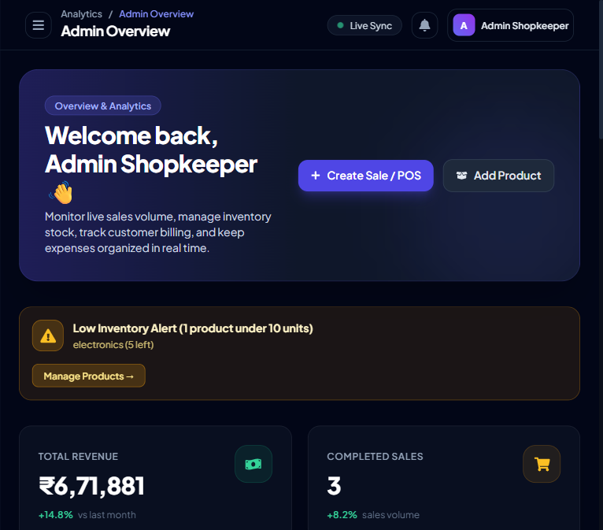
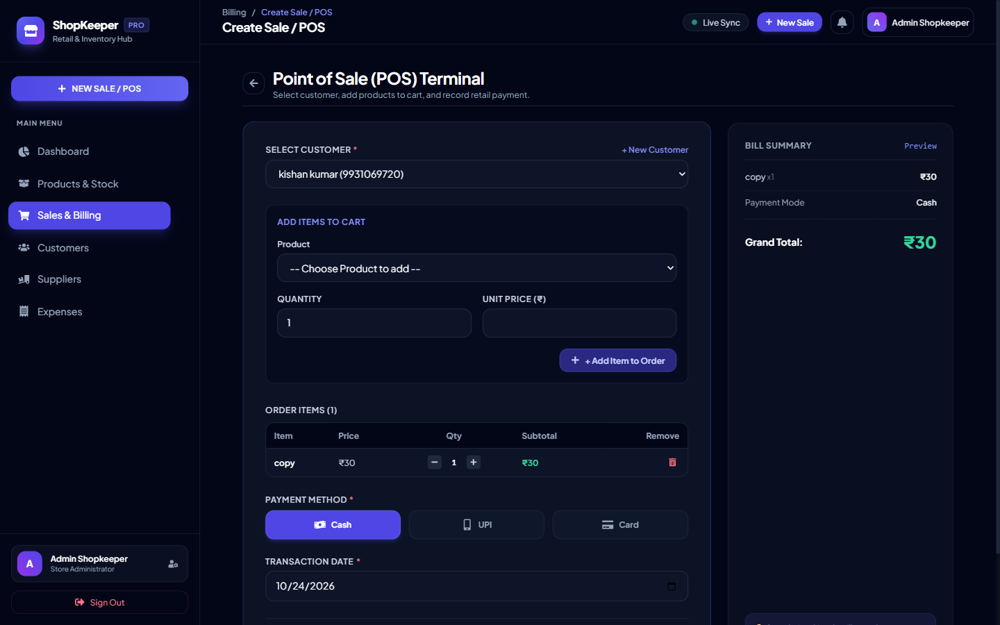
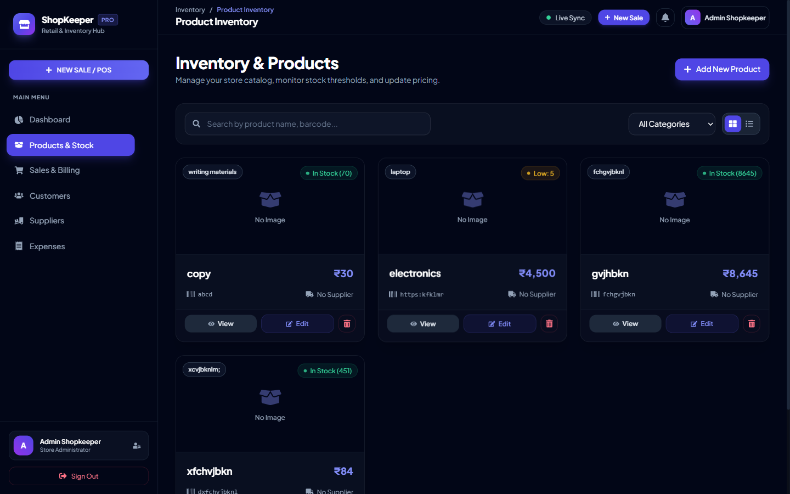
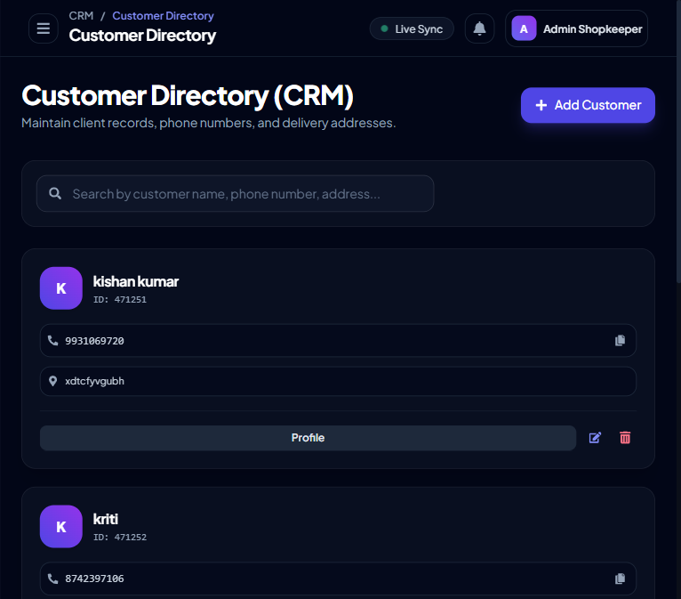
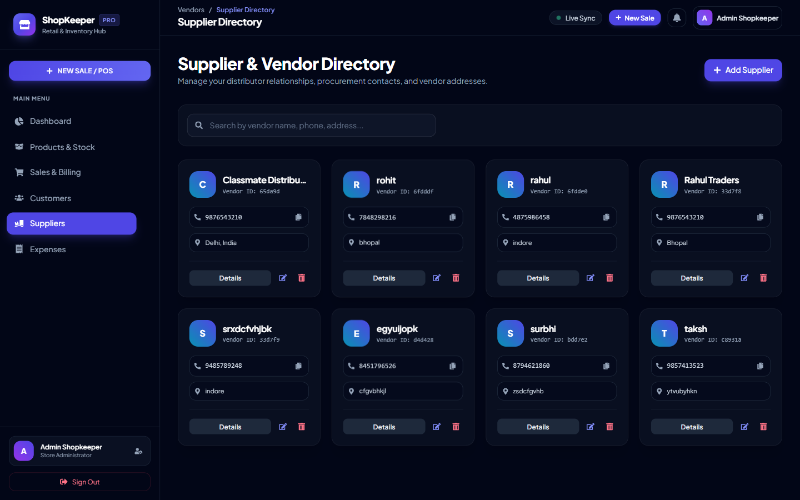
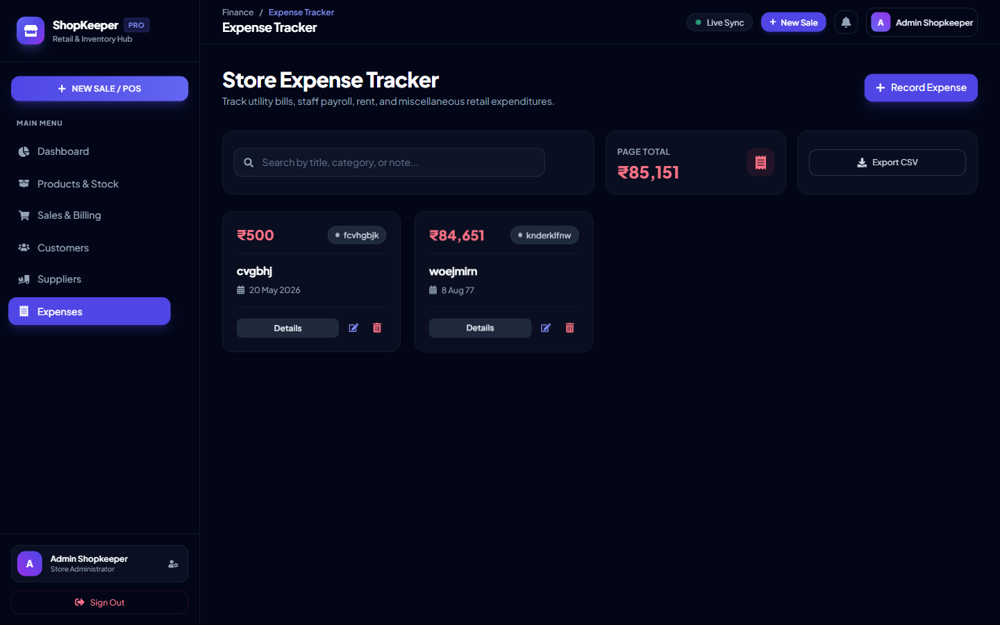
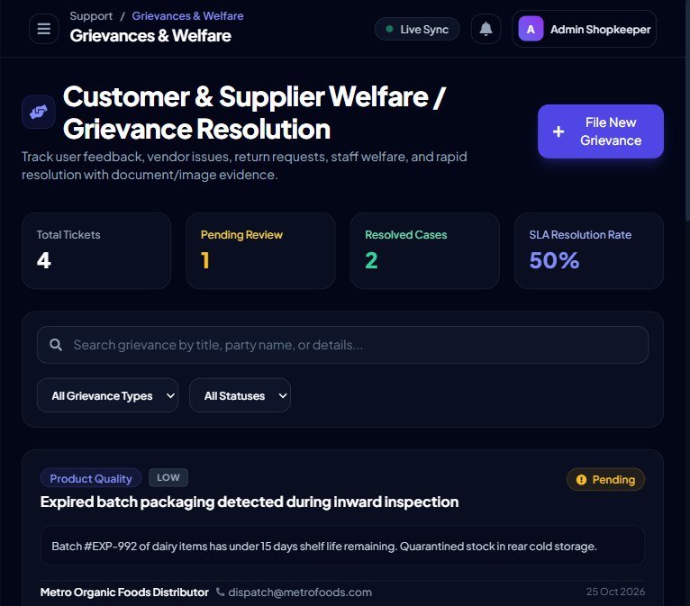
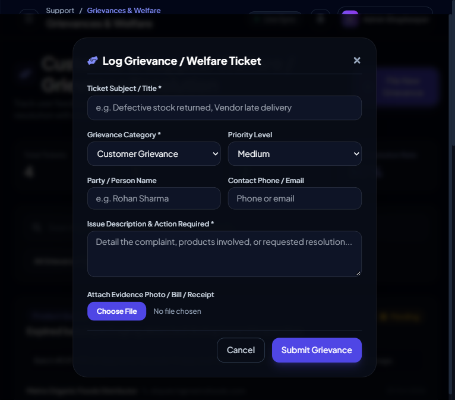
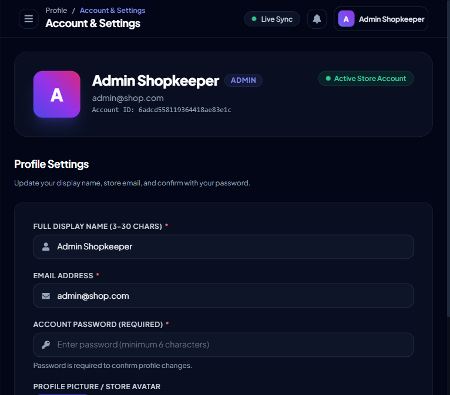
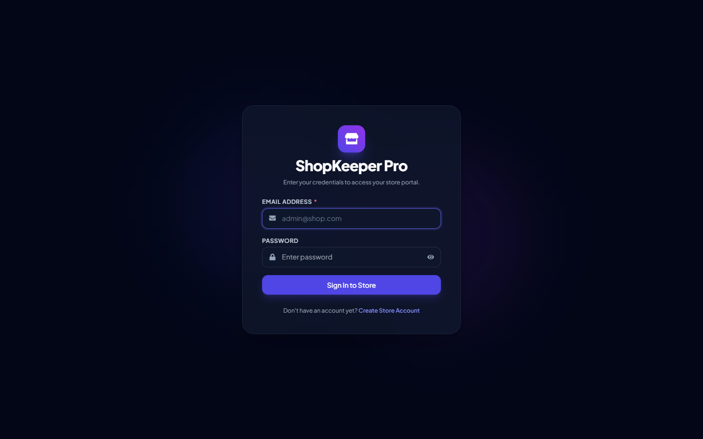

# 🏪 ShopKeeper Pro — Store Management, POS & Billing Platform

ShopKeeper Pro is a comprehensive, production-grade retail and inventory management application designed for shop owners, retail merchants, and enterprise distributors. It seamlessly orchestrates catalog tracking, barcode/SKU generation, real-time Point of Sale (POS) billing with multi-item carts, automatic stock decrement, low-inventory alerts, supplier & customer relationship management (CRM), expense auditing, CSV data exports, and automated PDF tax invoices.

---

## 📸 Application Screenshots & UI Showcase

### 📊 1. Executive Analytics & Real-Time KPI Dashboard
Real-time store overview tracking gross turnover, daily order count, catalog count, monthly sales trend, inventory composition, low-stock warnings, and WebSocket-driven live order toasts.



---

### 💳 2. Point of Sale (POS) Counter Terminal
High-speed checkout terminal with multi-item shopping carts, live customer selection, automatic stock decrement, real-time bill preview, and payment method options (**Cash**, **UPI**, **Card**).



---

### 📦 3. Inventory & Product Catalog
Switchable Grid and Table views with instant search, category filters, supplier indicators, and automated stock health badges (`In Stock`, `Low Stock`, `Out of Stock`).



---

### 👥 4. Customer Directory & CRM
Customer relationship ledger tracking verified 10-digit phone numbers, physical delivery addresses, and customer profiles.



---

### 🚚 5. Supplier & Vendor Directory
Procurement directory managing distributor contacts, warehouse addresses, and supply vendor relations.



---

### 💰 6. Store Expense Tracker
Categorized operational cost ledger tracking utility bills, payroll, store rent, and monthly totals.



---

### 🤝 7. Customer & Supplier Welfare / Grievance Resolution Board
Centralized ticket tracker handling customer complaints, vendor disputes, staff welfare, and product quality issues with SLA resolution metrics, priority filters, and attached evidence photos.



---

### 📝 8. Grievance Filing & Welfare Ticket Modal
Streamlined grievance lodging workflow supporting document attachments, category tagging (Customer, Supplier, Staff Welfare, Product Quality, Store Operations), and priority assignment.



---

### 👤 9. Store Administrator Profile & Avatar Management
Store settings interface with profile photo upload, store administrator credentials, and password-authenticated updates.



---

### 🔐 10. Secure Authentication Portal
Glassmorphic authentication interface with password visibility toggle, credential validation, and JWT session handling.



---

## 🚀 Key Features

- **Customer, Supplier & Staff Welfare Grievance Resolution**: End-to-end grievance resolution tracker for customer disputes, supplier delivery errors, staff working conditions, and product quality reports. Features full ticket lifecycle management (`Pending` -> `In Review` -> `Resolved` / `Rejected`), resolution audit notes, SLA performance percentage, and photo/bill evidence attachments.
- **Universal Multi-Part Image Upload System**: Seamless file upload capabilities integrated across the entire ecosystem:
  - **Product Catalog**: High-resolution item photos.
  - **Customer CRM**: Client photos and ID documentation.
  - **Supplier Directory**: Vendor company logos and supply contracts.
  - **Expense Ledger**: Attached physical receipts and utility bills.
  - **Store Profile**: Store administrator avatars.
  - *Storage architecture automatically routes to Cloudinary when configured, with a resilient local disk storage fallback.*
- **Point of Sale (POS) Terminal with Multi-Item Cart**: Rapid checkout counter allowing shopkeepers to add multiple items, adjust item quantities with `[+]` / `[-]`, and view real-time line subtotals and grand totals.
- **Automated Inventory Stock Decrement**: Selling items automatically decrements available warehouse/shelf quantities via MongoDB `$inc`. Deleting a sale automatically restores inventory stock.
- **Low-Stock Alert Dashboard Banner**: Automatically flags products with fewer than 10 units remaining so store managers can restock before stockouts occur.
- **CSV Data Export**: Instant client-side CSV downloads for **Sales Transactions** and **Expense Records** formatted for Excel and accounting tools.
- **Real-Time Barcode & SKU Generator**: Create standardized SKU codes (`SKU-XXXXXX`) with barcode preview capabilities.
- **Product Catalog Management**: Grid and table views with category filtering, image uploads, and stock status indicators.
- **Customer CRM**: Maintain customer records, purchase histories, and sanitized 10-digit phone verification.
- **Supplier & Procurement Directory**: Vendor directory with warehouse addresses, contact numbers, and restock tracking.
- **Expense Tracker**: Categorized business expenditure ledger (**Rent**, **Utilities**, **Salaries**, **Maintenance**, **Supplies**) with monthly summation.
- **Thermal & Tax Invoices**: Print-ready invoices formatted for A4 paper and thermal receipt printers with one-click PDF export via `jsPDF`.
- **Live Notifications**: Integrated Socket.io real-time alerts whenever a sale is completed on the POS terminal.
- **Security & Schema Validation**: Comprehensive Joi schema validation, password hashing via `bcrypt`, JWT authentication, HTTP security headers via `helmet`, and parameter pollution protection via `hpp`.

---

## 🛠️ Technology Stack

### Frontend
- **Framework**: React 19 + Vite 8
- **State Management**: Redux Toolkit + React Redux
- **Styling**: Tailwind CSS + Custom Dark Theme Glassmorphism
- **Typography**: Google Fonts (*Plus Jakarta Sans* & *Inter*)
- **Data Visualization**: Recharts (Interactive AreaChart & Donut Chart)
- **PDF Generation**: `jsPDF` + HTML2Canvas
- **Icons**: React Icons (FontAwesome 5/6)
- **Notifications**: `react-hot-toast`
- **Networking & WebSockets**: Axios + Socket.io-Client

### Backend
- **Runtime & Framework**: Node.js + Express 5
- **Database**: MongoDB Atlas with Mongoose ODM
- **Real-Time Sync**: Socket.io Server
- **Authentication**: JSON Web Tokens (`jsonwebtoken`) + `bcrypt`
- **Validation**: Joi (Schemas enforcing phone numbers, name lengths, and numeric limits)
- **File Uploads**: Multer + Cloudinary
- **Security Middlewares**: Helmet, HPP, Express-Mongo-Sanitize, Express-Rate-Limit, XSS-Clean

---

## ⚙️ Local Development Setup

### 1. Prerequisites
- Node.js (v18 or higher recommended)
- MongoDB Atlas cluster or local MongoDB instance

---

### 2. Fast Single-Command Setup (From Project Root)
You can now start everything directly from the repository root:

```bash
# 1. Install all dependencies
npm run install:all

# 2. Run backend
npm run dev

# Or run frontend:
npm run dev:frontend
```

---

### 3. Backend Setup
1. Open a terminal and navigate to the `Backend` directory:
   ```bash
   cd Backend
   ```

2. Install dependencies:
   ```bash
   npm install --legacy-peer-deps
   ```

3. Create a `.env` file in `Backend/.env`:
   ```env
   PORT=3000
   MONGO_URI="mongodb+srv://<username>:<password>@cluster0.mongodb.net/shopkeeper_management?retryWrites=true&w=majority"
   JWT_SECRET="your_secure_jwt_secret_key_min_32_chars"
   CLOUDINARY_CLOUD_NAME="your_cloudinary_name"
   CLOUDINARY_API_KEY="your_cloudinary_key"
   CLOUDINARY_API_SECRET="your_cloudinary_secret"
   ```

4. Start the backend server:
   ```bash
   npm start
   # or for development auto-reloading:
   npm run dev
   ```
   *The server will start on `http://localhost:3000` with WebSocket support enabled.*

---

### 4. Frontend Setup
1. In another terminal, navigate to the `Frontend` directory:
   ```bash
   cd Frontend
   ```

2. Install dependencies:
   ```bash
   npm install
   ```

3. Create a `.env` file in `Frontend/.env`:
   ```env
   VITE_API_URL=http://localhost:3000/api
   VITE_SOCKET_URL=http://localhost:3000
   ```

4. Start the Vite development server:
   ```bash
   npm run dev
   ```
   *The application will be live at `http://localhost:5173`.*

---

## 🚀 Deployment Guide

### Option A: Frontend Deployment (Vercel)
The Frontend includes [`vercel.json`](./Frontend/vercel.json) to handle Single Page Application (SPA) client-side routes.

1. Push your code to GitHub.
2. Sign in to [Vercel](https://vercel.com/) and click **"Add New Project"**.
3. Import your repository and set the **Root Directory** to `Frontend`.
4. Framework Preset: **Vite**.
5. Build Command: `npm run build`
6. Output Directory: `dist`
7. In **Environment Variables**, add:
   - `VITE_API_URL`: Your deployed backend API URL (e.g., `https://shopkeeper-backend.onrender.com/api`)
   - `VITE_SOCKET_URL`: Your deployed backend WebSocket URL (e.g., `https://shopkeeper-backend.onrender.com`)
8. Click **Deploy**.

---

### Option B: Backend Deployment (Render)
The repository includes a ready-to-use [`render.yaml`](./render.yaml) blueprint.

1. Sign in to [Render](https://render.com/) and select **"New" > "Blueprint"** (or "Web Service").
2. Connect your GitHub repository.
3. Configure the Web Service:
   - **Root Directory**: `Backend`
   - **Environment**: `Node`
   - **Build Command**: `npm install --legacy-peer-deps`
   - **Start Command**: `node server.js`
4. Add the following **Environment Variables**:
   - `PORT`: `3000` (or Render will provide `$PORT`)
   - `MONGO_URI`: Your MongoDB Atlas connection string.
   - `JWT_SECRET`: A secure 64-character random string.
   - `CLOUDINARY_CLOUD_NAME`: (Optional) Your Cloudinary Cloud Name.
   - `CLOUDINARY_API_KEY`: (Optional) Your Cloudinary API Key.
   - `CLOUDINARY_API_SECRET`: (Optional) Your Cloudinary API Secret.
5. In **MongoDB Atlas**:
   - Go to **Network Access** and ensure your IP Whitelist includes `0.0.0.0/0` (Allow Access from Anywhere) so Render servers can connect to the database.
6. Click **Create Web Service**.

---

## 📋 REST API Endpoints

### 🔐 User & Authentication (`/api/user`)
| Method | Endpoint | Description | Auth Required |
|---|---|---|---|
| `POST` | `/api/user/register` | Register new store owner | No |
| `POST` | `/api/user/login` | Authenticate user & issue JWT | No |
| `GET` | `/api/user/get/:id` | Fetch user profile by ID | No |
| `PUT` | `/api/user/update/:id` | Update profile (name, email, password) | Yes (Bearer) |
| `DELETE` | `/api/user/delete/:id` | Delete user account | Yes (Bearer) |

### 📦 Products & Inventory (`/api/product`)
| Method | Endpoint | Description |
|---|---|---|
| `GET` | `/api/product/get` | Paginated product list with search (`page`, `limit`, `search`) |
| `GET` | `/api/product/get/:id` | Get product details with supplier details |
| `POST` | `/api/product/create` | Create new product (supports multipart image upload) |
| `PUT` | `/api/product/update/:id` | Update product details or image |
| `DELETE`| `/api/product/delete/:id` | Remove product from inventory |

### 🛒 Sales & Point of Sale (`/api/sales`)
| Method | Endpoint | Description |
|---|---|---|
| `GET` | `/api/sales/get` | List sales transactions (supports payment method filtering) |
| `GET` | `/api/sales/get/:id` | Retrieve sale transaction by ID |
| `POST` | `/api/sales/create` | Record new POS transaction (auto-decrements product stock) |
| `PUT` | `/api/sales/update/:id` | Edit sale transaction |
| `DELETE`| `/api/sales/delete/:id` | Cancel/delete sale record (auto-restores product stock) |

### 👥 Customer CRM (`/api/customer`)
| Method | Endpoint | Description |
|---|---|---|
| `GET` | `/api/customer/get` | List all customers with pagination |
| `GET` | `/api/customer/get/:id` | Get customer profile |
| `POST` | `/api/customer/create` | Register customer (validates 10-digit phone) |
| `PUT` | `/api/customer/update/:id` | Update customer record |
| `DELETE`| `/api/customer/delete/:id` | Remove customer |

### 🚚 Supplier Management (`/api/supplier`)
| Method | Endpoint | Description |
|---|---|---|
| `GET` | `/api/supplier/get` | List all vendors and suppliers |
| `GET` | `/api/supplier/get/:id` | Get supplier details |
| `POST` | `/api/supplier/create` | Create supplier record |
| `PUT` | `/api/supplier/update/:id` | Update supplier record |
| `DELETE`| `/api/supplier/delete/:id` | Remove supplier |

### 💰 Expenses (`/api/expense`)
| Method | Endpoint | Description |
|---|---|---|
| `GET` | `/api/expense/get` | List store expenses |
| `GET` | `/api/expense/get/:id` | Get expense details |
| `POST` | `/api/expense/create` | Record store expense |
| `PUT` | `/api/expense/update/:id` | Update expense record |
| `DELETE`| `/api/expense/delete/:id` | Delete expense entry |

### 📄 Invoices & Analytics (`/api/invoice` & `/api/dashboard`)
| Method | Endpoint | Description | Auth Required |
|---|---|---|---|
| `POST` | `/api/invoice` | Generate linked tax invoice | Admin, Staff |
| `GET` | `/api/invoice/:id` | Fetch tax invoice by ID | Yes |
| `GET` | `/api/dashboard/stats` | Aggregate dashboard KPI metrics | Admin |

### 🤝 Grievances & Welfare Resolution (`/api/complaint`)
| Method | Endpoint | Description | Auth Required |
|---|---|---|---|
| `GET` | `/api/complaint/get` | List grievances with category and status filters | No |
| `GET` | `/api/complaint/get/:id` | Retrieve detailed grievance record by ID | No |
| `POST` | `/api/complaint/create` | File new grievance (supports multipart evidence image) | No |
| `PUT` | `/api/complaint/resolve/:id` | Update status, audit resolution note, resolve grievance | No |
| `DELETE` | `/api/complaint/delete/:id` | Delete grievance record | No |

---

## 🔒 Form Validation Rules (Joi Schemas)

To guarantee database integrity, all payloads conform to backend Joi validators:
- **Customer & Supplier Phone**: Exactly **10 digits** (`/^[0-9]{10}$/`). The frontend automatically strips non-numeric characters and country codes.
- **Customer & Supplier Name**: Between **4 and 60 characters**.
- **Customer & Supplier Address**: Between **4 and 60 characters**.
- **Product Name & Category**: Between **4 and 60 characters**.
- **Product Stock**: Must be **0 or higher** (supports accurate out-of-stock tracking).
- **POS Payment Method**: Must be one of `Cash`, `UPI`, or `Card`.
- **User Profile Update**: Requires confirmation password (**min. 6 characters**).

---

## 📄 License
This project is open-source under the ISC License.
